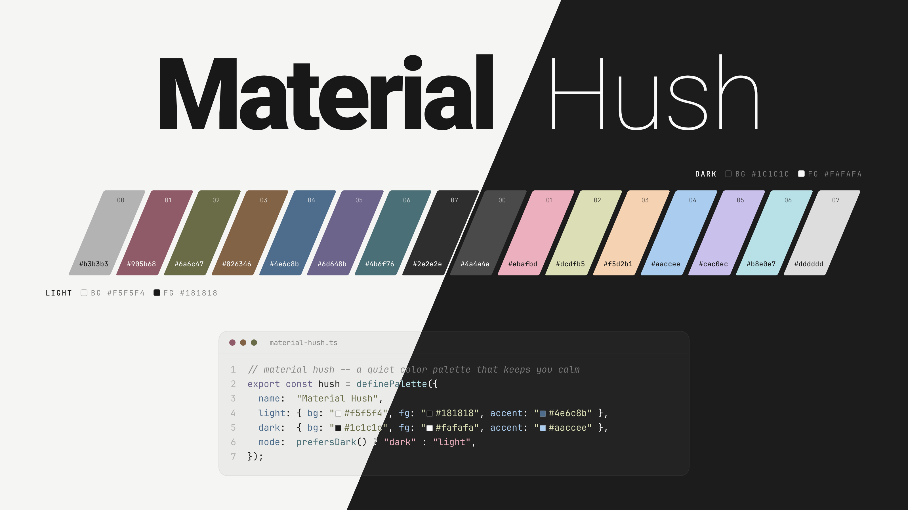

  

<b>A quiet color palette that keeps you calm.</b>

---

## Palette

| Color | Dark | Light |
| :--- | :--- | :--- |
| Background |  `#1c1c1c` |  `#f5f5f4` |
| Foreground |  `#fafafa` |  `#181818` |
| Black |  `#4a4a4a` |  `#b3b3b3` |
| Red |  `#ebafbd` |  `#905b68` |
| Green |  `#dcdfb5` |  `#6a6c47` |
| Yellow |  `#f5d2b1` |  `#826346` |
| Blue |  `#aaccee` |  `#4e6c8b` |
| Magenta |  `#cac0ec` |  `#6d648b` |
| Cyan |  `#b8e0e7` |  `#4b6f76` |
| White |  `#dddddd` |  `#2e2e2e` |

Bright colors mirror the normal ones (color8–15 = color0–7).

Light-mode accents are at about 5:1 contrast against the background, and dark-mode accents are at 9:1 or higher.

## Ports

| Port | Description | |
| :--- | :--- | :--- |
| [kitty](https://github.com/kovidgoyal/kitty) | Cross-platform, fast, feature-rich, GPU-based terminal | [Install](ports/kitty/) |
| [Alacritty](https://github.com/alacritty/alacritty) | Cross-platform, OpenGL terminal emulator | [Install](ports/alacritty/) |
| [Ghostty](https://github.com/ghostty-org/ghostty) | Fast, feature-rich, cross-platform terminal emulator with native UI | [Install](ports/ghostty/) |
| [WezTerm](https://github.com/wezterm/wezterm) | GPU-accelerated terminal emulator and multiplexer | [Install](ports/wezterm/) |
| [foot](https://codeberg.org/dnkl/foot) | Fast, lightweight and minimalistic Wayland terminal emulator | [Install](ports/foot/) |
| [Windows Terminal](https://github.com/microsoft/terminal) | Terminal app and console host for Windows | [Install](ports/windows-terminal/) |
| [Xresources](https://gitlab.freedesktop.org/xorg/app/xrdb) | X resource database, read by xterm, URxvt and other X apps | [Install](ports/xresources/) |
| [Neovim](https://github.com/neovim/neovim) / [Vim](https://github.com/vim/vim) | Vim-based text editors | [Install](https://github.com/ArneshRC/material-hush.nvim) |
| [VS Code](https://github.com/microsoft/vscode) | Code editor by Microsoft | [Install](ports/vscode/) |
| [Claude Code](https://github.com/anthropics/claude-code) | AI agent coding tool by Anthropic | [Install](ports/claude-code/) |
| [opencode](https://github.com/anomalyco/opencode) | Open-source AI coding agent | [Install](ports/opencode/) |
| [Telegram Desktop](https://github.com/telegramdesktop/tdesktop) | Official Telegram desktop client | [Install](ports/telegram/) |
| [ZapFast](https://github.com/crmne/zapfast) | Native Rust-based desktop client for WhatsApp | [Install](ports/zapfast/) |
| Web | CSS custom properties, Tailwind CSS v4 theme and W3C design tokens | [Use](ports/web/) |

Each port has a dark variant, Material Hush, and a light variant, Material Hush Light. Telegram Desktop and ZapFast are dark only.
